# RoSlop

A crew of 16 AI agents that builds Roblox games with you, running on your own Claude Code or Codex account.

You tell the Lead what you want. It splits the job into tasks and hands each one to the right agent. Builder writes the Luau, Scenic builds the world, Frame does the UI, the Librarian makes and textures models, Playtest plays it and reports what breaks, and Reviewer checks anything touching Robux or saves. They open Roblox Studio themselves, take screenshots and clips, and send them to you for a yes or a no. The Art Director checks every build and model against your references first, and sends weak work back before you ever see it.

It's a desktop app for Windows and Mac, a website for everything else, and your phone works as a remote.

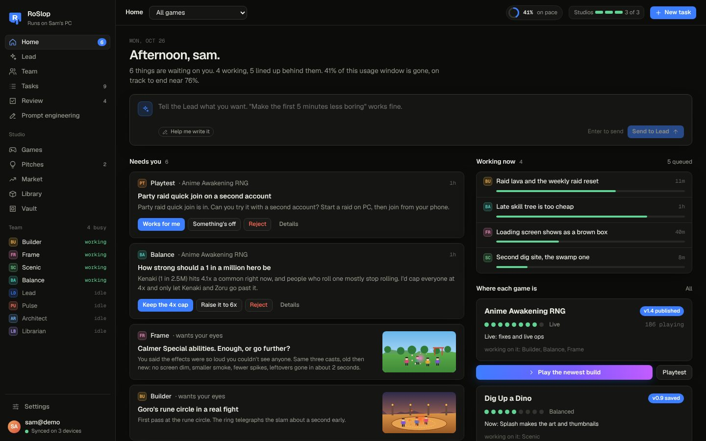

**New here? Read the [full guide](docs/GUIDE.md).** It covers what every page does, how the agents work and learn, and how to set everything up step by step. It's also in the app under **Guide**.

## Contents

- [What's in it](#whats-in-it)
- [Install](#install)
- [Setup, step by step](#setup-step-by-step)
- [Your first game](#your-first-game)
- [Getting great builds and art](#getting-great-builds-and-art)
- [It won't eat your usage](#it-wont-eat-your-usage)
- [Troubleshooting](#troubleshooting)
- [How it fits together](#how-it-fits-together)
- [Working on RoSlop itself](#working-on-roslop-itself)

## What's in it

| | |
|---|---|
| **Home** | What needs you, what's working, what's queued, and where each game is, with Play and Playtest buttons. |
| **Lead** | Chat with the Lead like a person. Ask what everyone is doing and it checks with each agent. Ask for work and you get tasks back. Attach references, model rules and a style for that one task. |
| **Team** | All 16 agents, what each one is doing right now and the brief the Lead wrote for it. |
| **Tasks** | Every job and where it's at. Lead requests jump the queue. |
| **Review** | Screenshots and clips from the crew. Approve, send back with a note, or reject (keys A, C, R). Click a picture to zoom. |
| **Prompt engineering** | Shows what the crew would have to guess from your prompt and fills the gaps, with saved templates. Runs in your browser, so it costs no usage. |
| **Games** | Live numbers from Roblox: players, visits, likes, passes, badges, servers, live ops, charts over any date range, and links to the Creator Dashboard. |
| **Pitches** | Game ideas from the charts, or acquisition pitches for a game you'd buy a stake in, priced from RoWatcher's revenue estimates. |
| **Market** | What's climbing on Roblox right now, with filters, benchmarks and breakouts. |
| **Library** | Your models, icons, sounds, VFX, animations, UI and references, in nested groups. Models and animations render live with their textures, sounds show waveforms, videos play, and `.rbxm` files say what's inside. Uploads go to Roblox through Open Cloud by themselves. |
| **Vault** | Your Obsidian notes. Agents read the ones that match their task. Paste links or drop pictures to add references straight into it, or pick pictures already in it and send them to the Library's References. |
| **Settings** | Usage limits, named Studios, style targets, computers and apps like Blender, connectors like Figma, and keys. |

<p>
  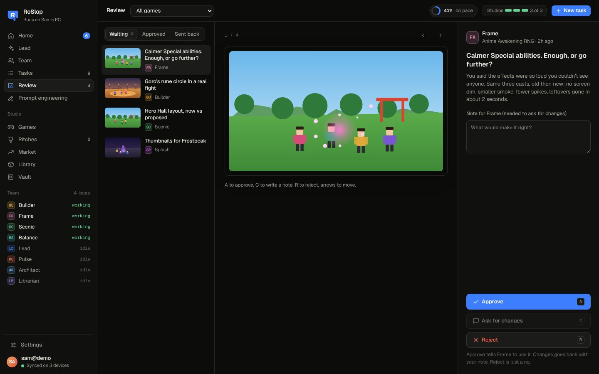
  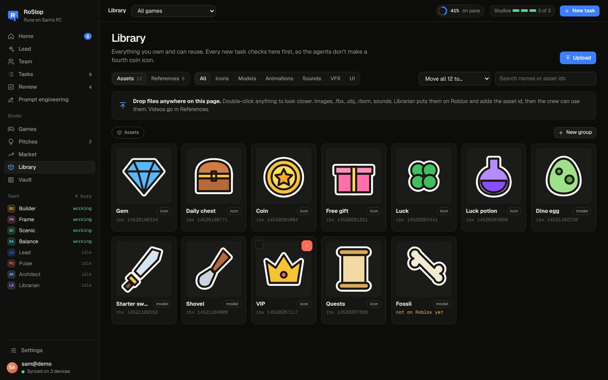
  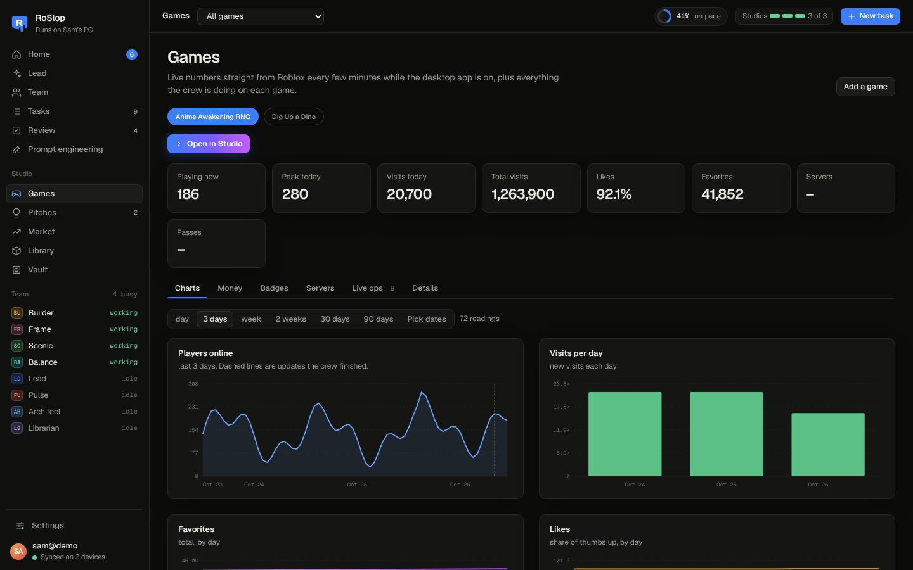
  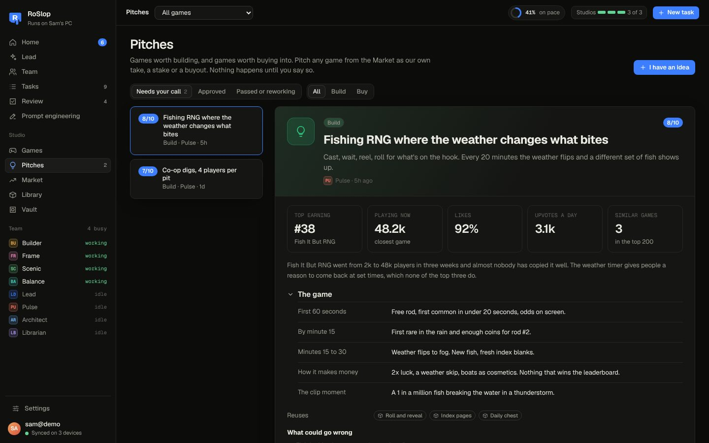
</p>

### The crew

| Agent | Does |
|---|---|
| Lead | Turns what you want into tasks, and tells you what everyone's up to |
| Pulse | Watches the charts, pitches games, prices acquisitions |
| Architect | Writes the game plan before anything gets built |
| Builder | Luau, systems, wiring it all together in Studio |
| Frame | UI that fits on a phone |
| Scenic | Maps, terrain, lighting and atmosphere |
| Librarian | Finds, models and textures assets, keeps the Library tidy |
| Balance | Simulates the economy so upgrades feel right |
| Clueless Tester | Plays with no idea what the game is and skips every tutorial |
| Playtest | Runs the game in Studio and reports what breaks |
| Splash | Thumbnails and icons |
| Merchant | Shops, passes and developer products |
| Producer | Keeps work moving and checks the proof |
| Reviewer | Money, saves and security before anything ships |
| Art Director | Judges builds, models and art against your references and sends weak work back |
| Liveops | Reads player numbers and plans the next update |

### Real agents that learn

Every agent is a full Claude Code (or Codex) agent session. It plans, uses tools, edits files, runs commands, drives Studio through MCP, screenshots its own work and fixes it. On top of that:

- **They learn from you.** Every approve, send back and reject, with your note, comes back to that agent on every future task as a rule, along with pictures of work you approved and the Art Director's notes. Agents also write down lessons as they work, into your vault under `Lessons`, where you can edit them. See what each one has learned on its Team page.
- **They hand work to each other.** Builder can pass a playtest to Playtest, and Scenic can ask the Librarian for a model, mid-task.
- **Autopilot.** Turn it on for a game, write its goal, and the Lead keeps planning the next most useful work by itself while usage allows.

Nobody can retrain the model itself on a Claude or Codex plan, so this is how the crew gets better: feedback, written down and brought to every job.

## Install

Grab the installer for your computer from the [latest release](https://github.com/21kingbigz/RoSlop/releases/latest):

- **Windows**: `RoSlop-…-win-x64.exe`
- **Mac with an Apple chip (M1 and newer)**: `RoSlop-…-mac-arm64.dmg`
- **Older Intel Mac**: `RoSlop-…-mac-x64.dmg`

The app isn't signed yet, so the first launch takes one extra click. On Windows, click **More info**, then **Run anyway**. On a Mac, right-click the app and choose **Open**.

When it opens you can **try the demo** straight away. It runs on sample data and nothing actually runs. To use it for real, follow the setup below.

## Setup, step by step

This takes about 15 minutes. You only do it once.

### 1. Make a free Supabase project

Supabase holds your account and your data, so your PC, browser and phone all see the same thing.

1. Make a project at [supabase.com](https://supabase.com). The free plan is fine.
2. Open the RoSlop app and choose to connect your own project. Paste the **Project URL** and the **anon public key** from Supabase under **Project Settings → API**, then hit **Connect**.
3. The app shows you the setup code. Copy it, open **SQL Editor** in Supabase, paste it and press **Run**. It's the file [`supabase/setup.sql`](supabase/setup.sql).
4. Make an account in the app with your email and a password.

> **After every update, run the setup code again.** It only adds what's missing and never deletes anything. If a setting says "saved on this device only", this is why.

Optional: GitHub or Google sign-in for the website. Both stay off until you set them up.

<details>
<summary>How to turn on GitHub or Google sign-in</summary>

The callback URL for both is `https://<your-project>.supabase.co/auth/v1/callback`.

- **GitHub**: GitHub → Settings → Developer settings → OAuth Apps → New OAuth App. Paste the callback URL, then put the Client ID and a new client secret into Supabase under **Authentication → Sign In / Providers → GitHub**.
- **Google**: Google Cloud Console → APIs & Services. Set up the OAuth consent screen, then **Credentials → Create OAuth client ID → Web application**. Add the callback URL as an authorized redirect URI, and put the Client ID and secret into Supabase under the Google provider.
- Under **Authentication → URL Configuration**, set the Site URL to wherever you host the website.

The desktop app uses email and password.
</details>

### 2. Install Claude Code (or Codex) on the computer that does the work

RoSlop runs on your own plan. Nothing goes through anyone else.

- **Claude Code**: on Windows, open PowerShell and run `irm https://claude.ai/install.ps1 | iex`. On a Mac, open Terminal and run `curl -fsSL https://claude.ai/install.sh | bash`. Then run `claude` once and sign in.
- **Codex**: install the Codex app and sign in. RoSlop uses the copy inside it.

The Claude desktop app counts too: if you've installed Claude Code from there, RoSlop finds it. If it can't, point at it by hand under **Settings → Computers and apps**.

### 3. Sign in on that computer

The first computer you sign in on with the desktop app becomes your **worker**, the one that runs agents. Others become backups or remotes, which you can change under **Settings → Computers and apps**.

### 4. Connect Roblox Studio

Agents drive Studio through Roblox's Studio MCP server.

1. Install it from [Roblox/studio-rust-mcp-server](https://github.com/Roblox/studio-rust-mcp-server) and follow its readme. It adds a plugin to Studio and a server to Claude.
2. If you added it to Claude Code (it appears in `claude mcp list`), RoSlop finds it under any name. Otherwise, paste its command under **Settings → Computers and apps → Roblox Studio MCP command**.
3. Under **Settings → Studios**, name your Studios (one per game or kind of game) and choose how many agents can have Studio open at once.

Studio stays in the background while agents work, and agents take their own screenshots of it to check what they built.

### 5. Add your games

On **Games**, hit **Add a game** and give it a name, its **universe id** and its project folder on the worker. To find the universe id, open the experience in [Creator Hub](https://create.roblox.com/dashboard/creations): it's the number in the address bar after `/experiences/`. Live numbers start showing within a few minutes, and agents work in the project folder.

### 6. Optional extras

- **Blender**: **Settings → Computers and apps → Scan** finds it. Then in **Settings → Connectors**, hit **Add Blender** (it needs the Blender MCP add-on turned on inside Blender). Agents use it to model and texture.
- **Figma**: **Settings → Connectors → Connect through the Figma app**. In the Figma desktop app, open a design file, switch to Dev Mode (Shift+D) and turn on the desktop MCP server. If Figma is already connected in Claude Code, RoSlop picks it up by itself.
- **Keys** (stay on that computer, encrypted, never synced):
  - **Roblox Open Cloud key** (Assets read and write) and **Roblox creator id**: your user id, or `group:123` for a group. With these, Library uploads go to Roblox by themselves.
  - **RoWatcher key**: deeper market and revenue data for Pitches and acquisitions.
  - **Discord webhook**: posts approvals to a channel.
- **Vault**: on **Vault**, pick a folder of Markdown notes, or press **Start building the vault** and the crew starts one in `Documents/RoSlop Vault`. Open it in [Obsidian](https://obsidian.md).

### 7. Your phone (optional)

Host `apps/web` anywhere static, like Vercel or Netlify, and sign in from your phone. It's a remote for your PC: approve work, chat with the Lead and check numbers from anywhere.

<p>
  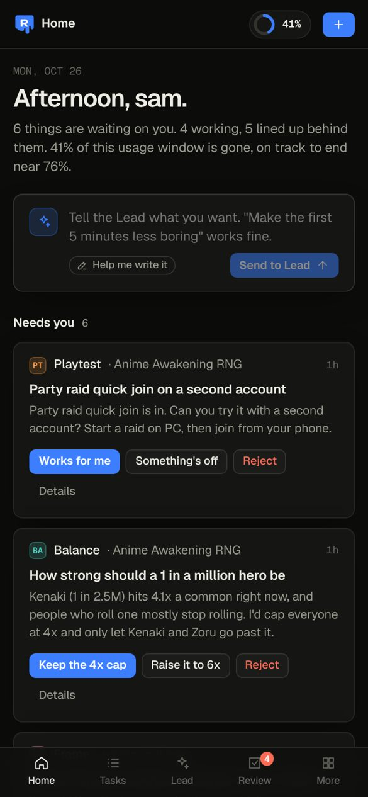
  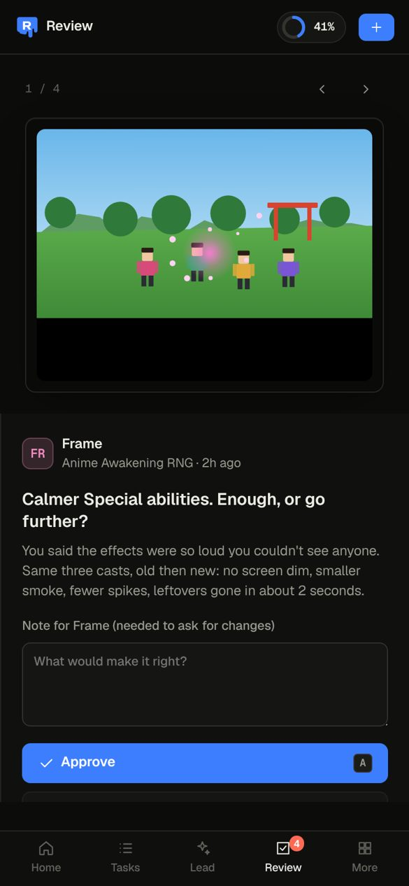
</p>

## Your first game

1. **Talk to the Lead.** Say what you want in plain words: *"Make a lava obby lobby with a shop and three portals. Cozy stylized look."* The Lead replies, and you'll see the tasks it made under **Tasks**.
2. **Attach what matters.** Under the chat box:
   - **Add reference files**: pictures or videos of the look you want.
   - **Style**: pick or paste gameplay videos to match. They're kept for this task, or saved for a kind of game.
   - **Model rules**: the style, triangle budget and texture size for anything modeled.
3. **Watch it work.** **Team** and **Home** show who's on what. Ask the Lead "what's everyone doing?" any time.
4. **Review.** Pictures and clips land in **Review**. Approve (A), send back with a note (C) or reject (R). Visual work has already passed the Art Director.
5. **Play it.** On Home, **Play** opens the game and **Playtest** has the crew test it.

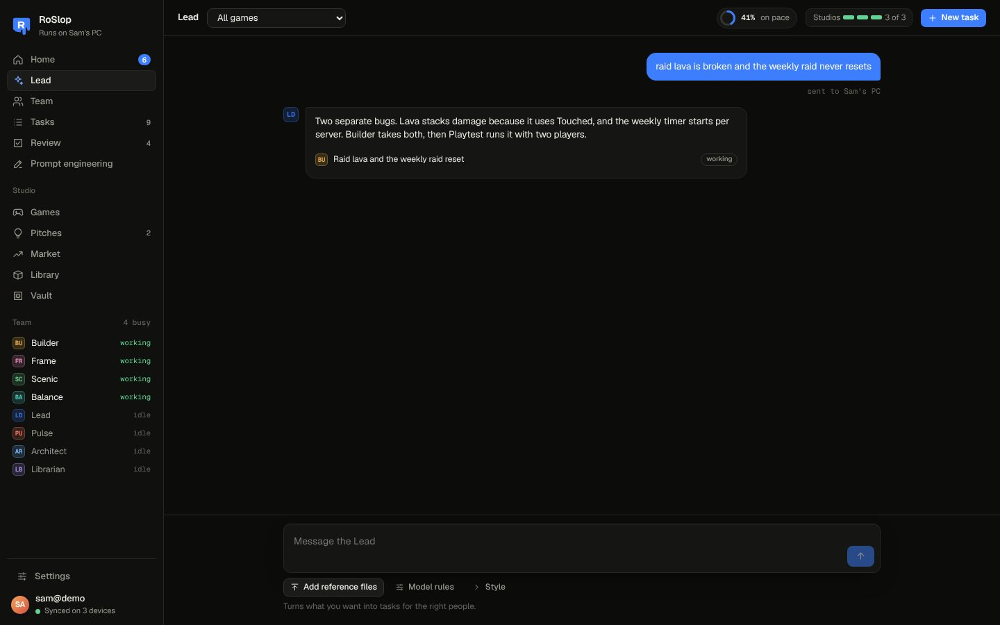

## Getting great builds and art

The crew builds to a high bar by default, but nothing beats showing it exactly what you want.

- **Style targets** (**Settings → Style targets**). Paste gameplay videos from YouTube, X, TikTok or Medal, or type a game's name, and save them for each kind of game (RPG, Simulator, Tycoon…). Your computer downloads each video once and pulls frames, and every build, model and art task studies them first. Use gameplay, not trailers made of drawings. Game icons don't help.
- **References in the Vault.** On **Vault → Add to references**, pick an area (Building, Modeling, VFX, UI…) and a topic, then paste links (pictures, X posts, YouTube clips, DevForum or ArtStation pages) or drop pictures. They go straight into `References/<area>` with no AI usage, and the crew treats them as the look to match.
- **Vault pictures to the Library.** On **Vault → Pictures in your vault**, pick pictures (shift-click for a run) and send them to the Library's References in a group.
- **Your Library comes first.** Every task gets your Library ranked for it, with Roblox ids and download links, plus your closest references and vault notes. Agents have to use your stuff before making anything new, and list what they used when they finish.
- **The Art Director** compares finished builds, models and art to your references and sends weak work back with specific notes, up to three rounds.
- **The guides** the crew follows are in your vault under `References/Building` and `References/Modeling`. They cover showcase builds, stylized RPG worlds, simulator and tycoon builds, pets, eggs, weapons and bosses, and hand-painted texturing. Edit them, and the crew follows your version.

<p>
  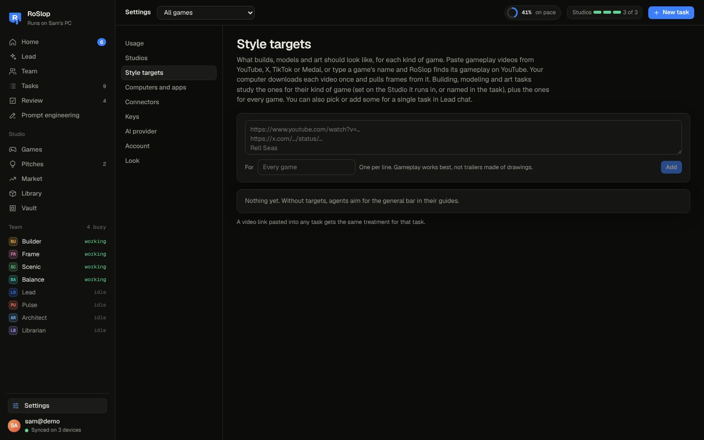
  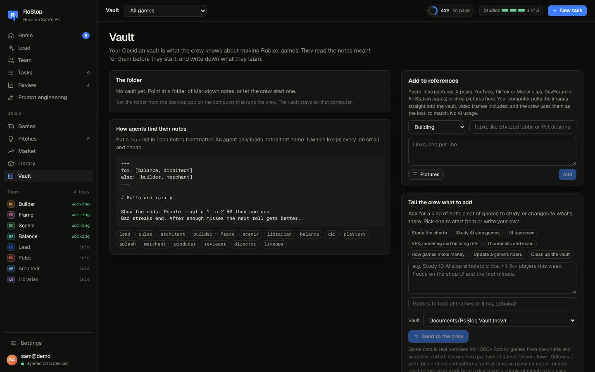
</p>

## It won't eat your usage

Claude plans give you usage that refills every 5 hours. Sixteen agents could burn through that in minutes, so RoSlop paces them.

- The crew stops at a line you pick (80% by default). The rest is yours.
- While usage is on pace, it runs as many agents at once as you set. If usage gets ahead of pace, it runs half as many, and one when it's well ahead, until it catches up. The Lead always answers first.
- Low priority work waits while you're ahead of pace.
- Each agent uses the smallest model that does its job well. Planning, reviews, building and art direction get the top model.
- Handoffs are summaries, agents only get the notes that match their task, and screenshots are shrunk.

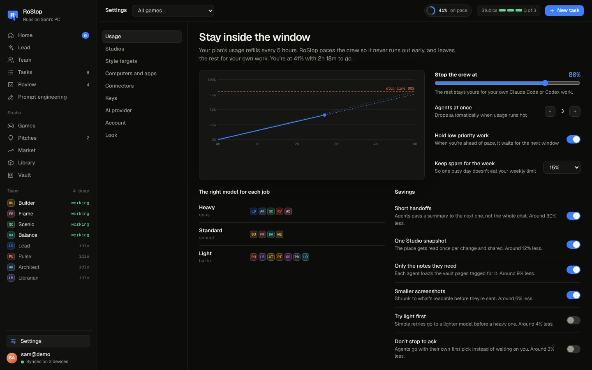

Details are in [docs/usage-pacing.md](docs/usage-pacing.md).

## Troubleshooting

<details>
<summary><b>"Claude Code isn't working on this computer"</b></summary>

- Install it (step 2 above), then run `claude` once in a terminal and sign in.
- **Windows: "running scripts is disabled on this system"**: run `Set-ExecutionPolicy -Scope CurrentUser RemoteSigned` in PowerShell, then install again.
- **Installed but not found**: close and reopen RoSlop so it picks up the new PATH, or point at `claude.exe` under **Settings → Computers and apps**.
</details>

<details>
<summary><b>Only one agent is working</b></summary>

The status line says why. Usually it's one of these:
- **Usage is ahead of pace**: it slows down until it catches up.
- **Studio slots**: agents that need Studio wait for a free one. Raise the limit under **Settings → Studios**.
- **Chained tasks**: some tasks are waiting for an earlier one to finish.
- **Agents at once**: check the number under **Settings → Usage**.
</details>

<details>
<summary><b>Agents can't use Studio</b></summary>

Check that the Studio MCP plugin is on in Studio and that the server shows in `claude mcp list`, or that the command is in **Settings → Computers and apps**.
</details>

<details>
<summary><b>A connector says "Not set up" or "Needs sign-in"</b></summary>

Hit **Check again** under **Settings → Connectors**. "Needs sign-in" means it's added but not signed in: run `claude`, type `/mcp`, pick it and sign in. For Figma, the **Connect through the Figma app** button skips the sign-in.
</details>

<details>
<summary><b>A style video won't download</b></summary>

If YouTube asks to confirm you're not a bot, sign in to YouTube in Firefox, Edge or Chrome on the worker computer. RoSlop uses that login. Private and age-restricted videos can't be used.
</details>

<details>
<summary><b>"Saved on this device only"</b></summary>

Your Supabase tables are missing a newer column. Run [`supabase/setup.sql`](supabase/setup.sql) again in the SQL editor.
</details>

<details>
<summary><b>A file won't upload</b></summary>

Supabase's free plan takes files up to 50 MB. Trim or compress it, or raise the limit under **Storage** in Supabase on a paid plan.
</details>

## How it fits together

```
 phone / browser ──┐
                   ├──  Supabase (login, data, live sync, files)  ──  desktop app on your PC
 desktop app UI ───┘                                                    ├─ runs claude / codex
                                                                        ├─ drives Roblox Studio, Blender, Figma
                                                                        ├─ uploads to Roblox (Open Cloud)
                                                                        └─ pulls game numbers and style videos
```

Only the desktop app on your worker runs agents. Everything else is a remote that reads and writes the same data, so anything you do on one device shows up on the others straight away.

### A word on safety

Agents run on your computer with permission to edit files and run commands in each game's project folder. That's what lets them use Studio, Blender and your tests. Keep project folders for game work, and read what Reviewer flags before you publish anything.

Keys you add in Settings are encrypted on that computer and never synced.

## Working on RoSlop itself

You need Node 20 or newer.

```
npm install
npm run dev            # the web app with demo data, at localhost:5173
npm run dev:desktop    # the desktop app, in a second terminal
npm test               # pacing, valuations and settings
```

Installers are built by GitHub Actions on real Windows and Mac machines. See [`.github/workflows/release.yml`](.github/workflows/release.yml).

```
apps/web        React app: the website, phone and desktop UI
apps/desktop    Electron shell and the runner that drives the agents
packages/core   Shared types, agents, pacing, valuations, and the agents' briefs and guides
supabase        Database setup
docs            How things work, and screenshots
design          Mockups
```

## License

MIT
