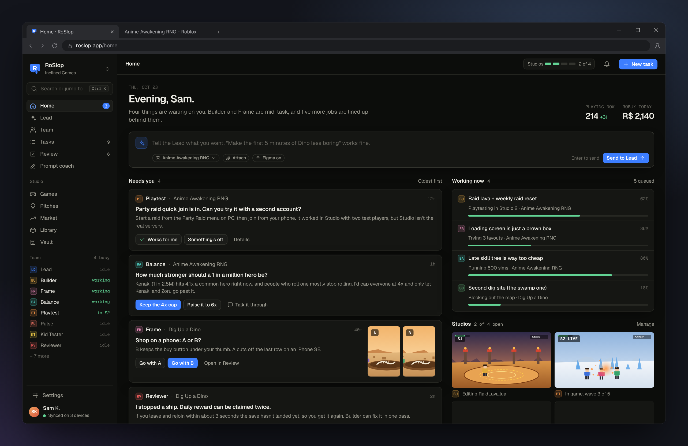

# RoSlop

A crew of 15 AI agents that builds Roblox games for you, running on your own Claude Code or Codex account.

You tell the Lead what you want. It splits the work into tasks and hands them to the right agents: Builder writes the code, Frame does the UI, Playtest plays it and reports what breaks, Reviewer checks anything touching Robux or saves. They open Roblox Studio themselves, take screenshots and clips, and send them to you for a yes or a no.

It runs on Windows and Mac as a desktop app, and anywhere else as a website. Your phone works too, as a remote.



## What's in it

- **Home** what needs you, what's working, what's queued
- **Lead** say what you want, get tasks back
- **Team** every agent, the brief the Lead wrote for it, what it's doing right now
- **Tasks** every job and where it is
- **Review** screenshots and clips from the crew. Approve, send back with a note, or reject. Keys A, C, R
- **Prompt coach** shows what the crew would have to guess from your prompt and fills the gaps. Runs in your browser, so it costs no usage
- **Games** live player numbers from Roblox, and where each game is in the pipeline
- **Pitches** game ideas from the charts with the reasons behind them
- **Market** what's climbing on Roblox right now
- **Library** your models, icons, sounds and references in one place
- **Vault** your Obsidian notes. Agents read the ones meant for them, and can start a vault for you
- **Settings** usage limits, computers, apps like Blender, connectors like Figma, keys

## It won't eat your usage

Claude plans give you usage that refills every 5 hours. Fifteen agents can burn through that in minutes if nothing holds them back, so RoSlop paces them:

- The crew stops at a line you pick (80% by default). The rest is yours.
- Work is spread across the window. Jobs that would run ahead of pace wait.
- Fewer agents run at once when usage is running hot.
- Each agent uses the smallest model that does its job well.
- Handoffs are summaries, agents only read the vault notes tagged for them, and screenshots get shrunk.

The details are in [docs/usage-pacing.md](docs/usage-pacing.md).

## How it fits together

```
 phone / browser ──┐
                   ├──  Supabase (login, data, live sync, files)  ──  desktop app on your PC
 desktop app UI ───┘                                                    └─ runs claude / codex
                                                                           └─ drives Roblox Studio, Blender…
```

Only the desktop app runs agents. Everything else is a remote that reads and writes the same data, so whatever you do on one device shows up on the others straight away.

## Try it

You need Node 20 or newer.

```
npm install
npm run dev
```

Open http://localhost:5173 and hit "Try the demo". With no database set up it runs on sample data kept in your browser.

## Set it up for real

**1. A Supabase project** (free tier is fine)

- Make a project at supabase.com.
- Run the files in `supabase/migrations` in order, in the SQL editor or with `supabase db push`.
- Optional: turn on GitHub or Google under Authentication → Providers for one-click sign in.
- Copy `apps/web/.env.example` to `apps/web/.env` and fill in the project URL and anon key.

**2. Claude Code or Codex** on the computer that'll do the work

Install one and sign in once (`claude` or `codex login`). RoSlop uses your plan, nothing goes through anyone else.

**3. The desktop app**

```
npm run build                         # web + desktop
npm run dist -w @roslop/desktop       # makes the installer in apps/desktop/release
```

While working on it, run `npm run dev` in one terminal and `npm run dev:desktop` in another.

Open it, sign in, and that computer becomes your worker. Add your games under Games, point Settings at the Roblox Studio MCP server if you want agents driving Studio, and scan for apps like Blender.

**4. The website** (optional)

`apps/web/dist` is a static site. Put it on Vercel, Netlify or Cloudflare Pages with the same two env vars, then sign in from your phone.

## A word on safety

Agents run on your computer with permission to edit files and run commands in each game's project folder. That's what lets them use Studio, Blender and your tests. Keep project folders for game work, and read what Reviewer flags before you publish anything.

Keys you add in Settings are encrypted on that computer and never synced.

## Layout

```
apps/web        React app. Website, phone and the desktop UI
apps/desktop    Electron shell and the runner that drives the agents
packages/core   Shared types, the agent list, pacing, and the agents' briefs
supabase        Database schema
design          Mockups
docs            Notes on how things work
```

## License

MIT
